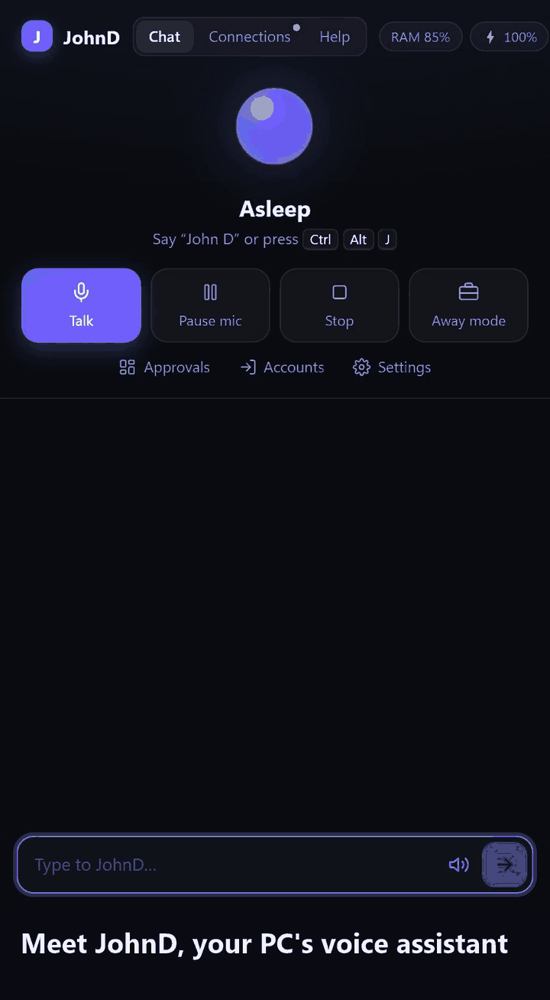

# JohnD Personal Assistant

**By Maverick Technologies**

JohnD is a voice assistant for Windows. Say "John D", then tell it what to do. It runs on your own PC: speech recognition and the AI brain work offline, and no account or API key is needed.

## Demo

Click the preview to open the full [demo video](JohnD_Demo.mp4).

## Download

Get **JohnD_Setup_1.7.0.exe** from the [latest release](../../releases/latest).

A licence key is required. JohnD asks for it the first time it opens.

## What it does

- **PC control by voice:** open and close apps, volume, screenshots, files and folders, timers and reminders.
- **Conversation:** talk to it and it answers out loud, in English, Urdu or Roman Urdu.
- **Smart tasks:** multi-step requests, document search, notes, daily briefing, weather and lookups.
- **Away mode:** reads your Gmail and prepares draft replies that you approve before anything is sent.
- **Private:** your data stays on your PC. Saved sign-ins are encrypted with Windows.

## Requirements

- Windows 10 or 11 (64-bit)
- A microphone
- 8 GB of RAM
- About 2 GB of free disk space, plus about 2 GB more if you add the AI brain
- Internet for the first start only (to download the speech files)

## Setup, step by step

### 1. Install

1. Download `JohnD_Setup_1.7.0.exe` from the [latest release](../../releases/latest).
2. Double-click it. Windows may show "Windows protected your PC" because the app is new: click **More info**, then **Run anyway**.
3. Follow the installer. It adds Start-menu and desktop shortcuts.
4. JohnD starts when setup finishes, and its window opens.

### 2. Activate your licence

1. The **Licence** box opens on first start.
2. Paste the key you received and press **Connect**.
3. You should see "Licensed to (your name)".

If your key is locked to one PC, the seller will ask for your machine code. It is shown in **Connections > Licence**.

### 3. Wait for the speech files

The first start downloads the speech files (about 190 MB). Keep the internet connected. You'll hear **"John D online"** when it's ready.

### 4. Add the AI brain (optional, free)

Without this step JohnD still does commands, weather, reminders and lookups. With it, JohnD can hold a conversation and do multi-step tasks.

1. In the JohnD window open **Connections > Thinking brain**.
2. Press the first button to install Ollama (a free program that runs the AI model on your PC).
3. Press **Download the AI model (about 2 GB)** and wait for it to finish.
4. The status changes to "Ready (llama3.2:3b)".

### 5. Connect Gmail for away mode (optional)

1. Open **Connections > Gmail**.
2. Enter your Gmail address and a Google **app password** (not your normal password). You create one in your Google account under Security > 2-Step Verification > App passwords.
3. Press **Connect**. JohnD will prepare draft replies; nothing is sent until you approve it.

### 6. Try it

- Say **"John D"**, wait for the beep, then speak. Or press **Ctrl + Alt + J**.
- You can also type in the JohnD window.
- The **Help** tab lists things to say.
- The round "J" icon near the clock: double-click to open the window, right-click for Settings, Pause microphone and Quit.

## Things to say

- "John D, open Notepad"
- "Set a timer for 10 minutes"
- "What's the weather in Lahore"
- "Take a screenshot"
- "Remember that my meeting is on Friday"
- "Find my resume"

## Problems

| Problem | Fix |
|---|---|
| "Windows protected your PC" | Click **More info**, then **Run anyway** |
| It doesn't hear "John D" | Check the microphone in Windows sound settings, or use Ctrl + Alt + J |
| No conversation answers | Finish step 4 (AI brain) |
| Window closed | Double-click the "J" icon near the clock |

## Uninstall

Windows Settings > Apps > JohnD > Uninstall.

## Licences

See [third-party notices](THIRD_PARTY_NOTICES.txt). The AI model is downloaded separately through Ollama. Built with Llama.

© Maverick Technologies. JohnD is commercial software; this repository holds the installer and documentation only.
